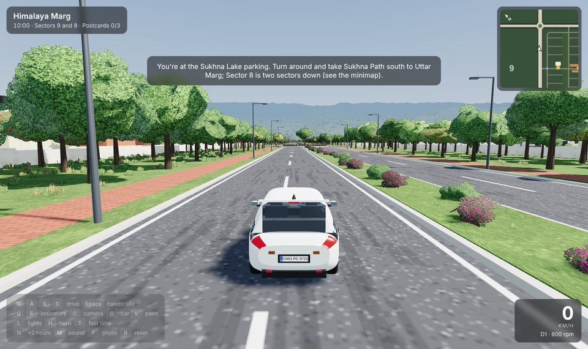
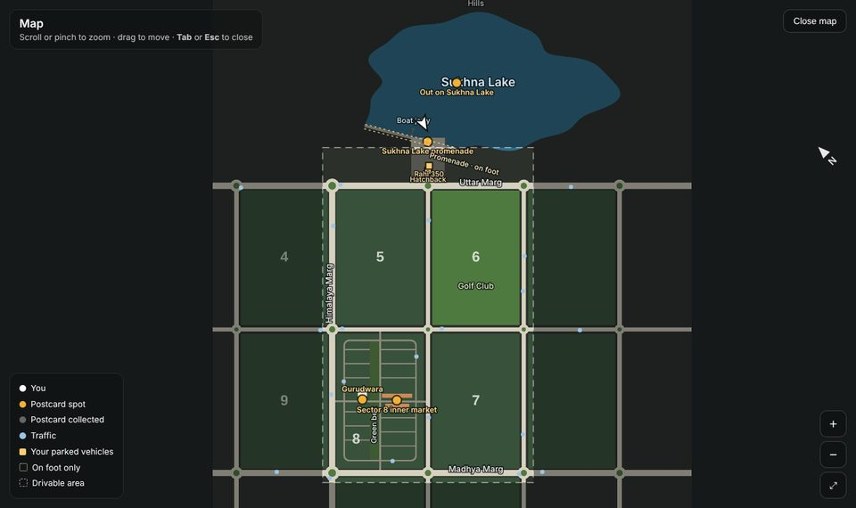

# Chandigarh Drive

A leisure driving game set in a half-scale Chandigarh, built to run in the browser. There's no racing and no timer: drive, ride or walk around Sukhna Lake and Sector 8, take a pedal boat out on the lake, and collect four postcard spots if you like.



## Play

Open `index.html` in a modern desktop browser. The game is a single self-contained HTML file; the only external dependency is Three.js r128, loaded from cdnjs.

If your browser blocks local files, serve the folder:

```sh
python3 -m http.server 8000
# then open http://localhost:8000
```

## What's in it

- **The city:** a real Chandigarh layout at half scale, including V2 and V3 roads (Uttar Marg, Madhya Marg and Himalaya Marg), clockwise roundabouts, left-hand traffic, and Sectors 4–9 with the Golf Club in Sector 6.
- **Sector 8:** houses, the inner market, the gurudwara and the green belt.
- **Sukhna Lake:**
  - the parking lot, the entrance gate and plaza with food kiosks, and a plaque
  - the full promenade along the dam, with food carts, benches, ducks and rowing-lane buoys
  - a boat club jetty with swan pedal boats you can take out on the water
- **Vehicles:**
  - a hatchback
  - an original supercar (Aandhi GT)
  - an original classic motorbike (Rahi 350) that leans into corners
- **On foot:** get out of any vehicle and walk or run. The promenade and jetty are on foot only.
- **World detail:**
  - AI traffic, a walking crowd, and leaf-card trees that sway in the wind
  - real 3D grass, a day/night cycle, headlights and street lamps
  - a minimap, a full map and an aerial camera

## Controls

| Key | Action |
| --- | --- |
| W A S D / arrows | Drive, ride or walk |
| Space | Handbrake (jump when on foot) |
| Shift | Run when on foot |
| F | Get out, or get into a car, the bike or a pedal boat |
| Tab | Full map (or click the minimap) |
| C | Camera: chase, far, cockpit/helmet, showroom, aerial |
| G / V | Swap vehicle / change paint |
| Q / E | Left / right indicator |
| L · H · M | Headlights · horn · sound |
| T / N | Speed up time / jump 2 hours |
| P | Photo mode (hide the overlay) |
| R | Reset |

On touch screens, on-screen buttons appear for steering, throttle, brake and F.

## Screenshots

| | |
| --- | --- |
|  |  |
|  |  |



## Tech notes

- Three.js r128, plain JavaScript, no build step.
- All textures, including the foliage atlas, grass, bark and signs, are drawn procedurally on canvas at load time.
- Static city geometry is merged per material. Trees, grass, lamps, parked cars and people are instanced.
- Trees use leaf-card crowns with a distance LOD and a wind shader.
- Grass tufts are placed using a top-down mask render. A height-map render lets you walk over curbs, medians and the jetty.
- The crowd uses five low-poly variants, with the walk cycle animated in the vertex shader.
- The walking character and riders are procedural and use two-bone IK for seated poses.
